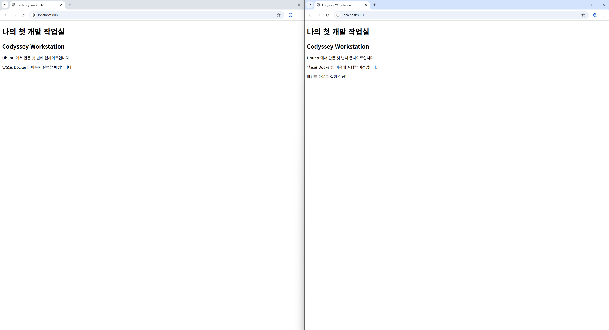
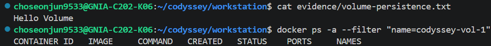
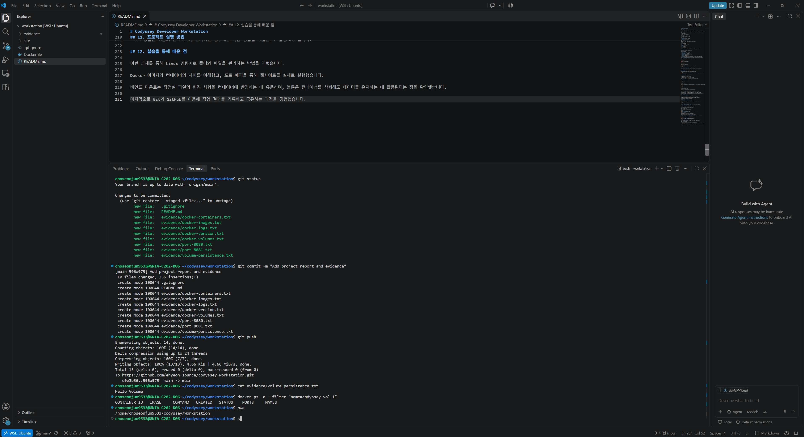

# Codyssey Developer Workstation

## 1. 프로젝트 개요

**과제:** 코디세이 1-1 — 내 컴퓨터에 개발자용 작업실 꾸미기

Windows 환경에서 WSL2와 Ubuntu를 이용해 Linux 개발 환경을 구축하고, Docker를 사용하여 간단한 웹사이트를 실행하는 프로젝트입니다.

터미널 명령어, 파일 접근 권한, 이미지와 컨테이너, 바인드 마운트와 볼륨, Git과 GitHub 사용법을 실습했습니다.

## 2. 개발 환경

| 항목 | 사용 환경 |
|---|---|
| 운영체제 | Windows + WSL2 Ubuntu |
| 터미널 | Bash |
| Docker | 29.9.2 |
| Git | 2.53.0 |
| 웹 서버 | NGINX (Alpine 기반) |
| 코드 편집기 | Visual Studio Code + WSL |
| 버전 관리 | Git / GitHub |

## 3. 프로젝트 구조

- `Dockerfile` — Docker 이미지 제작 설명서
- `site/index.html` — 웹사이트 HTML 파일
- `evidence/` — 실습 결과 증거 파일
- `README.md` — 프로젝트 보고서

## 4. Linux 및 파일 권한 실습

Ubuntu에서 다음 명령어를 사용하여 작업실 폴더와 파일을 관리했습니다.

| 명령어 | 기능 |
|---|---|
| `pwd` | 현재 위치 확인 |
| `cd` | 디렉터리 이동 |
| `mkdir` | 디렉터리 생성 |
| `ls -la` | 파일 목록과 권한 확인 |
| `touch` | 파일 생성 |
| `nano` | 파일 내용 편집 |
| `cat` | 파일 내용 출력 |
| `chmod` | 파일 접근 권한 변경 |
| `cp` | 파일 복사 |
| `mv` | 파일 이동 및 이름 변경 |
| `rm` | 파일 삭제 |

파일 권한 `644`는 소유자에게 읽기·쓰기, 그룹과 기타 사용자에게 읽기 권한을 부여합니다.

디렉터리 권한 `755`는 소유자에게 모든 권한을, 그룹과 기타 사용자에게 읽기 및 접근 권한을 부여합니다.

## 5. Docker 설치 및 컨테이너 운영

Docker Desktop과 Ubuntu의 WSL 연동을 설정했습니다.

**실행한 주요 명령어**

- `docker --version` — Docker 설치 확인
- `docker info` — Docker 엔진 연결 확인
- `docker run hello-world` — 첫 컨테이너 실행
- `docker images` — 이미지 목록 확인
- `docker ps -a` — 전체 컨테이너 확인
- `docker logs codyssey-ubuntu` — 실행 로그 확인
- `docker exec` — 컨테이너 내부 명령 실행
- `docker stats` — 자원 사용량 확인
- `docker stop` — 컨테이너 정지

`Hello from Docker!`가 정상 출력되었고 Ubuntu 컨테이너 내부에서 명령어를 실행하는 데 성공했습니다.

**증거:** [Docker 실행 로그](evidence/docker-logs.txt), [Docker 이미지 목록](evidence/docker-images.txt)

## 6. 웹사이트 이미지 제작 및 실행

NGINX를 이용해 웹사이트를 제공하는 Docker 이미지를 제작했습니다.

**Dockerfile**

```dockerfile
FROM nginx:alpine
COPY site/ /usr/share/nginx/html/
EXPOSE 80
```

**이미지 제작**

```bash
docker build -t codyssey-web:1.0 .
```

**웹 서버 실행**

```bash
docker run -d -p 8080:80 --name codyssey-web-8080 codyssey-web:1.0
```

브라우저에서 `http://localhost:8080`에 접속하여 웹사이트가 정상적으로 표시되는 것을 확인했습니다.

`8080:80`은 컴퓨터의 8080번 포트를 컨테이너 내부의 80번 포트에 연결하는 포트 매핑입니다.

**증거:** [8080 포트 매핑](evidence/port-8080.txt)

## 7. 바인드 마운트 검증

다음 명령어로 Ubuntu 작업실의 웹사이트 파일을 컨테이너에 연결했습니다.

```bash
docker run -d --name codyssey-bind-8081 -p 8081:80 -v "$PWD/site:/usr/share/nginx/html:ro" codyssey-web:1.0
```

`site/index.html` 파일에 다음 문장을 추가했습니다.

`바인드 마운트 실험 성공!`

**실험 결과**

- 8080번 웹사이트는 이전 내용을 유지했습니다.
- 8081번 웹사이트는 수정한 문장을 새로고침 후 표시했습니다.
- Docker 이미지를 다시 빌드하지 않고 변경 사항을 확인했습니다.

바인드 마운트는 호스트의 실제 폴더를 컨테이너에 연결하는 기능임을 확인했습니다.

**증거:** [8081 포트 매핑](evidence/port-8081.txt)

## 8. Docker 볼륨 영속성 검증

**볼륨 생성**

```bash
docker volume create codyssey-data
```

**데이터 저장**

```bash
docker run --name codyssey-vol-1 -v codyssey-data:/data ubuntu bash -c 'echo "Hello Volume" > /data/note.txt && cat /data/note.txt'
```

**컨테이너 삭제**

```bash
docker rm codyssey-vol-1
```

**새 컨테이너에서 데이터 확인**

```bash
docker run --rm -v codyssey-data:/data ubuntu cat /data/note.txt
```

**실행 결과:** `Hello Volume`

첫 번째 컨테이너를 삭제한 뒤에도 새 컨테이너에서 동일한 데이터를 읽을 수 있었습니다.

이를 통해 Docker 볼륨에 저장된 데이터는 컨테이너와 독립적으로 유지된다는 사실을 검증했습니다.

**증거:** [데이터 영속성 결과](evidence/volume-persistence.txt), [볼륨 목록](evidence/docker-volumes.txt)

## 9. 트러블슈팅

### 문제 1 — Ubuntu에서 Docker 명령어를 사용할 수 없음

**증상:** `docker --version` 실행 시 Docker 명령어를 찾지 못한다는 메시지가 출력됐습니다.

**원인:** Docker Desktop과 Ubuntu 간 WSL Integration 설정이 완료되지 않았습니다.

**해결:** Docker Desktop의 Settings → WSL Integration에서 Ubuntu 연결을 활성화했습니다.

**결과:** Ubuntu에서 Docker 버전이 정상 출력됐습니다.

### 문제 2 — Docker 엔진 접근 권한 거부

**증상:** `docker info` 실행 시 `permission denied`가 발생했습니다.

**원인:** 현재 Ubuntu 사용자가 Docker 소켓에 접근할 그룹 권한을 가지고 있지 않았습니다.

**해결:** 다음 명령어를 사용해 계정을 Docker 그룹에 추가한 뒤 Ubuntu 세션을 다시 시작했습니다.

```bash
sudo usermod -aG docker "$USER"
```

**결과:** `groups`에 `docker`가 추가됐고 `docker info`에서 서버 정보가 정상 출력됐습니다.

### 문제 3 — GitHub 로그인 브라우저 자동 실행 실패

**증상:** `gh auth login` 실행 중 브라우저를 자동으로 열지 못했습니다.

**해결:** GitHub 기기 인증 페이지에 직접 접속하여 인증을 완료했습니다.

**결과:** GitHub 로그인 및 프로젝트 업로드에 성공했습니다.

## 10. Git/GitHub 및 VS Code

Git 저장소를 생성하고 첫 커밋을 기록했습니다.

```bash
git init
git add Dockerfile site/
git commit -m "Initial workstation setup"
git remote add origin https://github.com/ehyeon-source/codyssey-workstation.git
git push -u origin main
```

GitHub에 프로젝트가 정상적으로 업로드된 것을 확인했습니다.

VS Code에 WSL 확장을 연결하고 Ubuntu 환경에서 프로젝트를 열었습니다.

VS Code 터미널에서 `pwd` 명령으로 `/home/choseonjun9533/codyssey/workstation` 경로를 확인했습니다.

## 11. 프로젝트 실행 방법

프로젝트를 내려받은 후 `Dockerfile`이 있는 폴더에서 다음을 실행합니다.

```bash
docker build -t codyssey-web:1.0 .
docker run -d -p 8080:80 --name codyssey-web-8080 codyssey-web:1.0
```

브라우저에서 `http://localhost:8080`으로 접속하면 웹사이트를 확인할 수 있습니다.

*이미 동일한 이름의 컨테이너가 존재하는 경우에는 이름 충돌을 해결한 후 실행해야 합니다.*

## 12. 실습을 통해 배운 점

이번 과제를 통해 Linux 명령어로 폴더와 파일을 관리하는 방법을 익혔습니다.

Docker 이미지와 컨테이너의 차이를 이해했고, 포트 매핑을 통해 웹사이트를 실제로 실행했습니다.

바인드 마운트는 작업실 파일의 변경 사항을 컨테이너에 반영하는 데 유용하며, 볼륨은 컨테이너를 삭제해도 데이터를 유지하는 데 활용된다는 점을 확인했습니다.

마지막으로 Git과 GitHub를 이용해 작업 결과를 기록하고 공유하는 과정을 경험했습니다.
## 13. 실습 화면 증거

### 1. 바인드 마운트 실험


### 2. Docker 볼륨 영속성 검증


### 3. VS Code와 Ubuntu 연결
